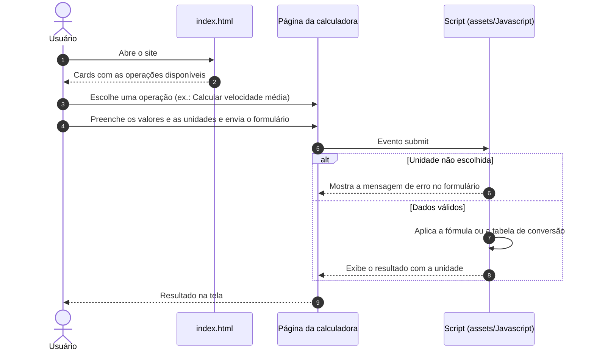
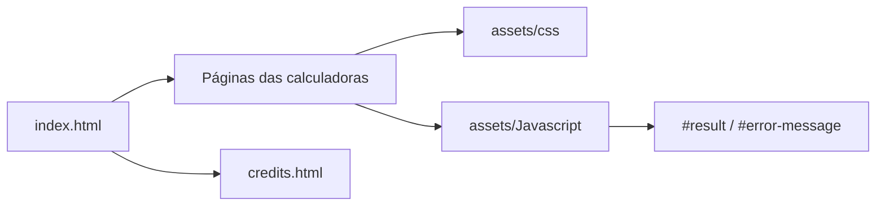

# 🧮 Calculadora de Física — Análise e Projeto de Sistemas


> Calculadoras de física no navegador: deslocamento, velocidade média, aceleração e conversão de unidades.

A **Calculadora de Física** é um site estático feito em **HTML, CSS e JavaScript puro** pelo grupo da disciplina de **Análise e Projeto de Sistemas** do curso técnico de **Desenvolvimento de Sistemas** da **ETEC Camargo Aranha**. Cada cálculo tem a sua própria página com um formulário; o resultado é calculado no próprio navegador, sem servidor e sem dependências instaladas. O site está publicado no **GitHub Pages**: **[matheusnascimentods.github.io/systems-analysis-and-design](https://matheusnascimentods.github.io/systems-analysis-and-design/)**.



---

## ✨ O Problema
Exercícios de cinemática exigem repetir as mesmas contas e conversões várias vezes:
- **Contas repetitivas**: deslocamento, velocidade média e aceleração seguem fórmulas simples, mas fáceis de errar à mão.
- **Conversões confusas**: passar de km/h para m/s, ou de cm para km, exige lembrar o fator certo a cada vez.

---

## 🚀 A Solução
Um site simples, com uma página por operação:
- **Calcular velocidade média**: `Vm = ΔS / Δt`, com a unidade de distância (cm, m, km) e de tempo (s, min, h) escolhidas pelo usuário.
- **Converter velocidade média**: entre km/s, km/h, km/min, m/s, m/h e m/min.
- **Calcular deslocamento**: `ΔS = S − S₀`, em cm, m ou km.
- **Converter unidades de medida**: entre cm, m e km.
- **Calcular aceleração**: `a = (V − V₀) / Δt`, com velocidades em m/s e resultado em m/s².

---

## 🎯 Diferenciais
- **Zero instalação**: HTML, CSS e JavaScript puros; basta abrir o `index.html` ou acessar o GitHub Pages.
- **Cálculo no navegador**: nenhum dado sai da máquina do usuário.
- **Mensagens de erro no formulário**: as páginas avisam quando nenhuma unidade foi escolhida e, nas conversões, quando as duas unidades são iguais.
- **Layout responsivo**: `assets/css/responsive.css` ajusta o layout com media queries a partir de 768px.
- **Página 404 própria**: `404.html` com o mesmo visual do site e link de volta ao início.

---

## 🛠️ Stack Tecnológica

| Camada | Tecnologia |
|---|---|
| **Marcação** | HTML5 |
| **Estilos** | CSS3 (`reset.css`, `style.css` e `responsive.css`) |
| **Lógica** | JavaScript puro (um script por calculadora) |
| **Ícones** | Ionicons 5.5.2 (via unpkg) |
| **Hospedagem** | GitHub Pages |

---

## 🏛️ Arquitetura

Não há build nem framework: cada página HTML carrega as folhas de estilo compartilhadas e o seu próprio script, que escuta o `submit` do formulário (`#form`), lê os campos, calcula e escreve o resultado em `#result`.



---

## 🗺️ Telas & Rotas

| Página | Tela | O que entrega | Script |
| :--- | :--- | :--- | :--- |
| `/index.html` | Início | Cards com as cinco operações e link para os créditos | — |
| `/average-speed.html` | Calcular velocidade média | Distância e tempo com unidade → velocidade média | `average-speed.js` |
| `/convert-average-speed.html` | Converter velocidade média | Conversão entre km/s, km/h, km/min, m/s, m/h e m/min | `convert-average-speed.js` |
| `/displacement.html` | Calcular deslocamento | Ponto inicial e final → deslocamento | `displacement.js` |
| `/convert-units-of-measure.html` | Converter unidades de medida | Conversão entre cm, m e km | `convert-units-of-measure.js` |
| `/aceleration.html` | Calcular aceleração | Velocidade final, inicial e tempo → aceleração em m/s² | `aceleration.js` |
| `/credits.html` | Créditos | Integrantes do grupo e link para o repositório | — |
| `/404.html` | Página não encontrada | Página de erro do GitHub Pages | — |

### Capturas de tela

<table>
  <tr>
    <td align="center" width="33%"><br/><sub>Página de início</sub></td>
    <td align="center" width="33%"><br/><sub>Cálculo de aceleração</sub></td>
    <td align="center" width="33%"><br/><sub>Créditos</sub></td>
  </tr>
</table>

---

## 📁 Estrutura do Projeto

```text
systems-analysis-and-design/
├── assets/
│   ├── css/                      # reset.css, style.css e responsive.css
│   ├── img/                      # Logo, favicon e ícones dos cards
│   └── Javascript/               # Um script por calculadora
├── Documentation/
│   ├── Calculadora 1ºDA APS.docx # Documentação do trabalho
│   ├── diario-de-bordo.docx      # Diário de bordo do grupo
│   ├── Screenshots/              # Capturas das telas
│   └── Video.mp4                 # Vídeo de apresentação
├── index.html                    # Página inicial
├── average-speed.html
├── convert-average-speed.html
├── displacement.html
├── convert-units-of-measure.html
├── aceleration.html
├── credits.html
├── 404.html
└── LICENSE.txt
```

---

## ⚡ Quick Start

### Acessar online
**[https://matheusnascimentods.github.io/systems-analysis-and-design/](https://matheusnascimentods.github.io/systems-analysis-and-design/)**

### Rodar localmente
```bash
git clone https://github.com/matheusnascimentods/systems-analysis-and-design.git
cd systems-analysis-and-design
```

Abra o `index.html` no navegador. Os ícones são carregados do unpkg, então é preciso estar conectado à internet para vê-los.

---

## 💻 Comandos Úteis

```bash
# Servir o site localmente (qualquer servidor estático serve)
python3 -m http.server 8000
# Acesse http://localhost:8000
```

---

## 🔒 Segurança & Boas Práticas

- **Sem backend e sem dados pessoais**: todos os cálculos acontecem no navegador.
- **Validação simples**: os campos numéricos são `required`; os scripts verificam a escolha das unidades e, na aceleração, recusam tempo menor ou igual a zero com uma mensagem de erro.
- **Velocidade média na unidade escolhida**: o resultado sai nas unidades informadas (ex.: `km/h`, `m/min`); a conversão entre unidades fica na calculadora de conversão de velocidade média.
- **Dependências externas**: Ionicons vem de CDN, sem SRI.
- **Vídeo de apresentação versionado**: `Documentation/Video.mp4` (cerca de 50 MB) é a apresentação do projeto e fica no repositório junto com a documentação.

---

## 👥 Créditos

Trabalho em grupo da disciplina de Análise e Projeto de Sistemas (ETEC Camargo Aranha), conforme a página [`credits.html`](credits.html):

| Integrante | Papel |
| :--- | :--- |
| Lorenzo Brunelli Oropallo | Tester |
| Lucas Martins Siqueira | Back-end |
| Matheus Nascimento dos Santos | Front-end e back-end |
| Murilo de Souza Alves | Documentação |
| Rafael Henrique Dias de Souza | Documentação |

---

## 🤝 Contribuindo

1. Faça um Fork do projeto
2. Crie uma branch para a sua funcionalidade (`git checkout -b feature/nome-da-feature`)
3. Abra as páginas alteradas no navegador e confira os cálculos
4. Faça o commit das suas alterações (`git commit -m 'feat: implementa nova funcionalidade'`)
5. Envie para o repositório remoto (`git push origin feature/nome-da-feature`)
6. Abra um **Pull Request** detalhando as alterações

---

## 📄 Licença

Distribuído sob a licença MIT. Veja [`LICENSE.txt`](LICENSE.txt) para mais detalhes.

---
Feito com ❤️ por [@matheusnascimentods](https://github.com/matheusnascimentods)
